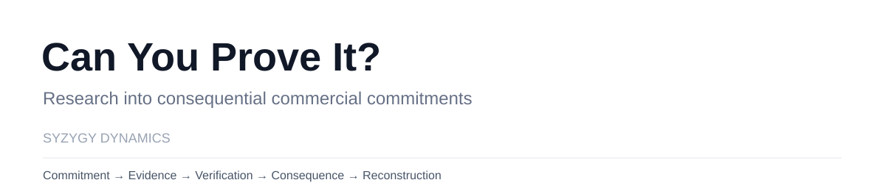

# Can You Prove It?

> **We reconstruct consequential commercial commitments from evidence—so people can see what is established, what remains unresolved, and what decision or economic outcome depends on it.**

**Company:** Syzygy Dynamics  
**Public research and first customer entry point:** Can You Prove It?  
**Core capability under development:** Recon — reconstruction of real-world situations and changes from evidence.  
**Long-term thesis:** AUM is infrastructure for bounded commitments.

These names describe different layers of one effort—not four separate products. We are testing the work manually before claiming it is a repeatable product.

## Start here

- **Have a real commitment to examine?** [Request a private Commercial Commitment Audit](docs/research/can-you-prove-it.md).
- **Want to see the method applied to a real dispute?** Read [NTRO Evidence Audit 001](docs/research/ntro-evidence-audit-001.md).
- **Want the concrete method and example?** Read the [Commitment Audit method](docs/research/can-you-prove-it.md) and [worked commitment teardown](docs/research/commitment-teardown.md).
- **Want to understand the current scope?** Read [Recon: now and destination](docs/research/recon-now-and-destination.md).
- **Want to check what is proven versus still a hypothesis?** Read [Commercial Validation](docs/VALIDATION.md) and [Validation Status](docs/status/VALIDATION_STATUS.md).

## The problem we are investigating

Commercial commitments connect work to consequences:

**delivery → acceptance → payment, handover, release, or another obligation**

But evidence about those states is often spread across contracts, emails, project records, test results, acceptance certificates, operational systems, invoices, and payment records. A status report may say “complete” while the evidence needed for acceptance or payment remains disputed or missing.

The question is not merely whether a milestone is marked complete. It is:

> **What state is the commitment actually in, what does the available evidence establish, what remains unresolved, and what must happen for the next consequential state to change?**

This can matter in enterprise software implementation, go-live acceptance, project recovery, milestone disputes, and other situations where a decision depends on reconstructing a changing real-world state. These are candidate applications, not claims that one product already solves all of them.

## How we work

For one bounded situation, we reconstruct:

**Required outcome → observed state → evidence-supported gap → unresolved questions → decision and authority → action → verified state change → economic consequence**

We keep separate:
- what a source says and what is independently established;
- allegations, findings, observations, and interpretations;
- what was knowable at the time and what became clear later;
- technical completion, acceptance, entitlement, enforceability, and actual realization;
- a possible intervention and a demonstrated economic benefit.

Missing or conflicting evidence remains visible. We do not turn uncertainty into a confident answer, or treat a later outcome as proof that an earlier intervention was possible.

**The work is manual today.** Recon is being developed to make evidence collection, chronology, comparison, state-change tracking, and disciplined reporting more repeatable. It is not yet an autonomous investigator, prospect-ranking engine, predictor, or proven commercial product.

## What the names mean

| Name | Role |
|---|---|
| **Syzygy Dynamics** | The company building and validating this capability. |
| **Can You Prove It?** | The public research and private commitment-audit entry point. |
| **Recon** | The reconstruction capability: source records → observations → states → changes → investigation. |
| **Evidence OS** | The underlying discipline for provenance, temporal history, and the boundary between observation and established fact. |
| **AUM** | The long-term thesis for infrastructure around bounded commitments—not a validated product claim today. |
| **Guarantees** | One possible economic application, initially explored around defined enterprise implementation milestones—not the entire company identity. |

## Current research wedge

We are beginning with enterprise software implementation and acceptance because these situations can connect operational evidence to consequential commercial states.

We are examining:
- implementation milestones, UAT, and acceptance;
- production deployment and go-live;
- payment triggers and disputed completion;
- evidence that is fragmented, contradictory, or difficult to reconcile;
- who has authority to recognize a condition and who can take the next action.

This is the first validation environment, not the boundary of the underlying reconstruction capability.

## Read the research

- [Research index](docs/research/README.md)
- [NTRO Evidence Audit 001: when implementation, testing, acceptance, and payment diverge](docs/research/ntro-evidence-audit-001.md)
- [Commercial Commitment Audit method](docs/research/can-you-prove-it.md)
- [Worked commitment teardown](docs/research/commitment-teardown.md)
- [ERP implementation acceptance](docs/research/erp-implementation-acceptance.md)
- [Go-live acceptance](docs/research/go-live-acceptance.md)
- [Milestone payment disputes](docs/research/milestone-payment-disputes.md)
- [Enterprise software implementation reference case](examples/enterprise-software-implementation.md)

## Bring one real case

We are looking for a practitioner and one **real, current situation** where a commitment, acceptance condition, readiness state, or payment remains unresolved and a consequential decision is still open.

A suitable first case should let us establish:
1. the required outcome and the evidence available now;
2. the gap, if any, that can actually be supported;
3. what remains unknown or contested;
4. who can make the relevant decision and what options are feasible;
5. whether the reconstruction changes or confirms a consequential decision.

Start with the [private Commercial Commitment Audit method](docs/research/can-you-prove-it.md). We will assess suitability and agree scope and any fee before reviewing substantive evidence. **Do not post confidential contracts, customer data, credentials, personal data, or sensitive operational records in a public issue or discussion.** A short, redacted description is enough to start; submitting one does not guarantee acceptance into the research.

## What is established—and what is not

| Signal | Current status |
|---|---|
| Public research and audit method | Published |
| Historical cases examined from public records | Yes; manual research, not proof of product effectiveness |
| NTRO Evidence Audit 001 | Published; based primarily on judicial records, with underlying primary records still missing |
| Private intake test | Passed by the founder; not proof of recurring inbound demand |
| Practitioner contribution to a live case | Not yet secured |
| First paid pilot | Not yet secured |
| Pricing and repeatable acquisition | Not validated |
| Commercial guarantee issued | No |
| Demonstrated, attributable economic benefit from Recon | Not yet established |
| Product-market fit | Not established |

A historical reconstruction is not the same as a live case. A published report is not a customer. A changed or confirmed decision is not automatically economic benefit. Third-party contract values are not company revenue.

Our progress standard is:

**Observed problem → real situation → reconstruction → consequential decision → measurable outcome → paid work → repetition**

We will not treat more documentation, repository activity, or architecture as a substitute for market evidence.

## Our governing principle

> **Reality first. Evidence before claims. Economics before expansion. Technology only where repeated work earns it.**

The central question remains:

> **Can an independent reconstruction establish what is happening, what the evidence supports, what remains unresolved, and whether that changes a consequential decision?**

---

## Repository boundary

This public repository contains company direction, research, examples, and commercial validation. Implementation work continues in separate engineering repositories.

## License

MIT
